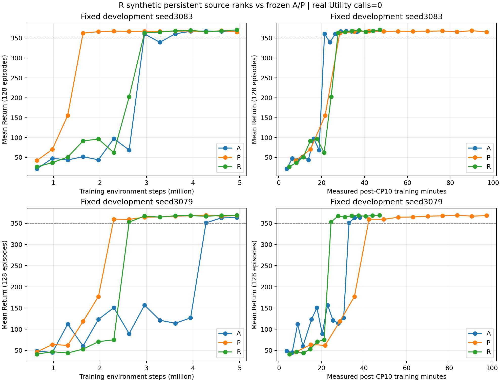

# R: random source priority CP150 results

R improves environment-step AUC over frozen Uniform A on both development seeds,
but loses part of P's improvement. It halves measured training time versus P.
It does not meet the preregistered within-10% AUC criterion for being close to P.

## Protocol

Branch codex/random-source-priority. Source commit 1232aff1d0a06ff63d140feb0722929a000fa8ab.
Base f1cdb57b63cfda9c843a4a82acd163ead1df7fa3: stable S/P and corrected sampler; no M/GA changes.
Original A native complete CP10 restored per seed: GA, Replay, optimizers, PRNG included.
Swimmer, pop32, [256,256], batch256; alpha0.5, temperature0.5, freshness30, minresident4.
3/4 current EA sources per generation,32per10generations;448 priorities per run.
Primary trapezoidal Return AUC20..150 over0.65M..4.94M training steps; eval10g x128episodes.
Seed3083 R/A gain8.50% passed the fixed>=5% second-seed gate. Both seeds completed150.
No intermediate tuning, alternative seed search or statistical significance claim.

## Performance

AUC below is divided by1e6. First350 means first scheduled mean Return>=350.
Minutes sum synchronized post-CP10 training step wall, including compilation/scoring/sampling;
evaluation/checkpoint I/O and shared warmup excluded for ALL arms. Seed3079 A includes
both original11..50 and51..150 continuation timings. Unknown historical warmup cost is not imputed.

|Seed|Arm|AUC/1e6|Final Return|Last5 mean|Training min|First350 generation / steps|First350 training min|
|---|---|---:|---:|---:|---:|---|---:|
|3083|A|894.049714|366.112|365.799|36.425|90 / 2,960,000|21.376|
|3083|P|1352.259690|365.512|367.132|96.953|50 / 1,640,000|28.464|
|3083|R|970.001576|370.645|368.632|47.206|90 / 2,960,000|27.714|
|3079|A|666.324718|363.336|263.567|38.012|130 / 4,280,000|32.956|
|3079|P|1170.463639|368.049|367.663|97.535|70 / 2,300,000|42.356|
|3079|R|1006.395552|368.779|367.909|47.248|80 / 2,630,000|24.526|

|Seed|R/A AUC|R/P AUC|R/P training time|R/A training time|R process wall min|
|---|---:|---:|---:|---:|---:|
|3083|+8.50%|-28.27%|0.487x|1.296x|49.477|
|3079|+51.04%|-14.02%|0.484x|1.243x|49.518|

Seed3083 R/A both first reach350 atg90; R takes longer than A.
Seed3079 R reaches350 atg80 vs A130/P70, and in less measured training time than both.
Reduced P total compute therefore does not imply universal wall-time advantage over A.

## Mechanism and limits

Both R runs: zero true Utility evaluations, virtual Critic updates, reference/source minibatches.
Forbidden diagnostic entrypoints raise; real GPU smoke tripwired Utility/source-batch builders.
The normal real TD3 optimizer remains active. Priorities require no additional environment rollout.
Legacy arm=utility/diagnostic flag/tag3 are frozen table ABI compatibility only;
all R records explicitly label synthetic_random_cohort_rank and measured_utility=false.
R raw_score is not measured Learner Utility.

P/R selected source IDs match140/140 generations on BOTH seeds. Mean eligible coverage
is9.09946% for all four P/R runs; EA-conditional TV is1.47809% (differences<1e-7).
Thus coarse coverage and TV amplitude alone do not explain the Return gap.
Same cohort permutation/lifetime does not mean identical realized random priorities:
R canonical ranks follow source-ID order; P canonical ranks depend on true Utility.
After permutation their rank-to-source assignments can differ despite the same marginal law.
Read-only checksum-verified P CP150 states each have100 eligible sources in31 active cohorts,
no raw Utility ties and no incomplete grids. This observation applies only at CP150.
P may reject nonfinite Utility; R checks finite rollout payloads. R also uses the baseline
jitted EC collector instead of P's raw diagnostic path. Equal training budgets do not
prove identical numeric trajectories. No causal reason for the remaining performance gap is established.

A further confound remains: P/R replace EA sampling using an independent intervention RNG;
original A does not use that overlay. No matched-RNG Uniform overlay was run.
Do not attribute gains uniquely to persistent nonuniformity or claim Utility-specific benefits.
Actual TD3 traces20/150 in both R runs changed EA, kept every RL slot and origin fixed;
index bounds passed. Final training/GA PRNG streams match frozen A.
Per run Actor updates2,240,000, Critic updates4,480,000. Four native checkpoint seals
10/50/100/150 verified. Replay writing, TD3, GA and corrected sampler code unchanged.
Targeted tests3passed; real tiny Brax GPU smokePASS; no historical full-suite rerun.

## Budget and decision

Per seed NEW4.620M training +1.792M evaluation steps; existing0.320M warmup reused.
Both pilots9.240M training +3.584M evaluation; tiny smoke3,088 additional steps.
Total new physical interactions12,827,088; zero priority-only environment interactions.
R process walls together98.995min including restore/evaluation/I/O; measured training94.453min.
No frozen A/P training repeated or overwritten.

Retain R as a promising low-cost development baseline, not a P-equivalent replacement.
R is outside both preregistered near-A(+/-5%) and near-P(+/-10%) bands on both seeds.
Do not immediately scale training. A small controlled comparison of priority persistence,
coverage/recency and the overlay RNG is the useful next step before adaptive priorities.
Random weighting itself is not presented as a paper contribution.

All artifacts remote: /disk1/zmh_projects/evorl_artifacts/learner_utility_replay_pilot/algorithm/random-source-priority-v1
Keep preregistration/configs, raw logs, per-seed summaries, complete native checkpoints,
schedule.jsonl, critic-input-20/150.npz, comparison.json, learning_curves.csv/png/pdf,
final-verification.json, frozen-P-ranks.json and smoke/test evidence.
Seed3083 and3079 are separate development results, the latter conditionally activated.
