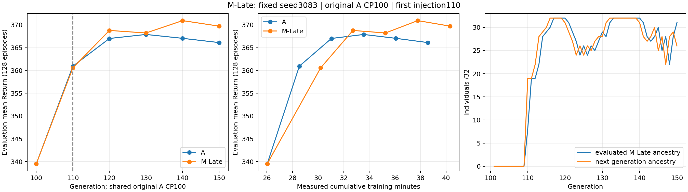

# M-Late: fixed seed3083 late-start performance experiment

Completed actual GPU training and one frozen CP150 Utility diagnostic. Primary AUC100-150 is+0.41% versus Uniform A, within the prospective+/-2% descriptive near band. This is outcome B: late start may alleviate early M harm, but this run does not establish a performance innovation or justify scaling/adding Utility machinery.

## Fixed contract and provenance

- Training commit:cff0fe9f542f0119a419109d4ae45a1c67ab1362; branchcodex/rl-guided-late-pilot; base1f16fb2.
- Exact unchanged scripts/rl_guided_population.py, ordinary GA/TD3/Uniform Replay and original periodic single-Actor injection. Only original A CP100 recovery and M start110 differ from earlier M scheduling.
- Parent is ORIGINAL Uniform A CP100, not old M CP100:

    /disk1/zmh_projects/evorl_artifacts/learner_utility_replay_pilot/algorithm/s-utility-replication-seed3083-v1/runs/A/segments/eacf2ffb25574622990fa3e1fe56a8ed/checkpoints/100

- Restored complete learner/targets/Adam/GA/Replay/PRNG/runtime SHA256:b6c3b71a8633ef40ee0d68463c92306df8e8e113b85730128c2e36490e41bdf8. Native file seals and full-state digest checked on real GPU restore;3290000 steps at parent.
- Before rollout110,120,130,140,150 replace tail8 of32 with4 pairs current Actor+/-0.005*epsilon. Other24 positions are unchanged at replacement and subsequently follow original GA; they can contain earlier M-Late descendants. No ancestry quota is imposed.
- Primary fixed before outcomes: trapezoidal AUC100..150 over3.29M..4.94M steps, including shared CP100 endpoint. Every10g128evaluation episodes. No interim tuning or early stop. +/-2% is a practical descriptive band, not statistical significance/equivalence.
- Newly execute50 generations,1.65M training steps,640k evaluation steps,800k Actor/1.6M Critic updates. Full logical final4.94M steps,2.24M Actor/4.48M Critic updates match A. No A retraining, old Smoke or old large test-suite rerun.

## All planned Return measurements

| Generation | Uniform A | M-Late | Difference |
|---|---:|---:|---:|
|110|360.936523|360.569550|-0.366974|
|120|367.010345|368.775574|+1.765228|
|130|367.892578|368.214417|+0.321838|
|140|367.042145|370.927917|+3.885773|
|150|366.111816|369.718719|+3.606903|

| Metric | A | M-Late |
|---|---:|---:|
|AUC100-150 (Return*steps)|599181819.763184|601626894.378662|
|Final Return|366.111816|369.718719|
|Cumulative measured training minutes|38.5727|40.3035|

Primary gain:+0.4081%; final Return difference:+3.606903. Old M, recomputed on this SAME100..150 interval, has AUC545929208.393097 (-8.8876% versus A). Its former-25.35% result uses60..150 and is not compared directly with this new interval.

## Actual training cost

New50-generation M-Late process wall:15.4751minutes; synchronized step sum:14.2667minutes. Historical A matchingg101..150 step sum:12.5358minutes. M-Late first resumed step91.331s includes cold JIT; subsequent mean15.606s. Thus the segment comparison includes restoration/compilation and lightweight evidence costs, not just pure algorithm overhead.

Cumulative comparable time charges each arm the measured common A prefix throughCP100 plus its own step seconds, excluding evaluation/checkpoint I/O. Total M-Late/A measured training change:+4.49%. One optional CP150 frozen diagnostic took28.331seconds with0environment interactions. No compute-efficiency benefit is established.

## Mature Actor quality and genuine breeding

| Injection generation | Fresh8 mean Fitness | Other24 mean Fitness | Old M fresh8 at same generation | M-Late next-population ancestry /32 |
|---|---:|---:|---:|---:|
|110|364.375450|78.560661|179.849502|19|
|120|367.970978|101.741456|212.189520|31|
|130|368.134144|106.579642|359.869495|28|
|140|369.090469|79.111281|365.768829|31|
|150|367.058346|94.528051|365.165325|26|

40 fresh candidates yield1104 subsequent ancestry trajectory-source slots (including GA offspring and retained elite copies),1159 parent uses and41 generations with M-lineage selection. At150,31/32 evaluated policies have M-Late ancestry; next saved population has26/32. The next population is saved, not rolled out beyond150.

The large Fitness increase at110/120 relative to old M supports the intended mature-Actor condition. Genuine selection strongly propagates the new lineages. It still does not identify Actor quality alone as the cause of the AUC change: late start also changes prior Replay/population/learner history and cumulative intervention dose. All comparisons are one development seed.

## Optional CP150 real Utility

Reuse the existing diagnostic with explicit new root and generation150 arguments; no new scoring framework. All source groups use one frozen M-Late Critic/targets/real Adam snapshot and3common256-transition reference batches, real TD3 loss and discarded step1 Optax update. Both A/M-Late full-state hashes remain unchanged;198 reference-measurement rows,0extra rollout steps.

Utility is post-update/current-resident-data, not pre-exposure. A data are same-generation cross-run counterfactuals not written into M-Late Replay. Their exposure/familiarity differs from M-Late sources. Raw reused source labelsM-* mean M-Late in this directory. No-M-ancestry includes ordinary single-Actor injection ancestry and is not necessarily independent initial GA ancestry.

Values below aggregate the3references per distinct source, then mean/median/positivity across source means. Related descendants and opposite pairs are not independent training seeds. Utility columns x1e3.

| Source | Distinct IDs / ref rows | Mean x1e3 | Median x1e3 | Positive source means | Fitness mean |
|---|---:|---:|---:|---:|---:|
|M-descendant|23/69|-3.439964|-1.695782|4.35%|82.512801|
|M-direct|8/24|-0.587642|-0.607395|0.00%|367.058380|
|M-no-derived-ancestry|1/3|-0.720345|-0.720345|0.00%|370.878540|
|Original-EA-A|32/96|-3.342456|-2.231296|0.00%|66.879524|
|RL-own|1/3|-0.561422|-0.561422|0.00%|360.462097|
|Replay-random|1/3|-0.252191|-0.252191|0.00%|-|

Direct policies retain high Fitness and have less-negative Utility than A counterfactual EA, but are not better than RL-own or Replay-random. Descendant mean Utility is slightly worse than A-EA and most source means remain negative. The no-M group has only1source. This one snapshot does not establish stable learner-Utility superiority or justify Utility-guided collaboration.

The CP150 saved next-population fixed-observation pair distance is1.441951 M-Late versus1.549282 A; observations are shared CP100 data. Broad phenotypic variation remains, while M-Late ancestry dominates. The high direct Fitness (367.06) versus descendant Fitness (82.51) suggests offspring-quality retention deserves study; it is descriptive, not a controlled causal test of mutation damage.

## Decision and verification

Outcome B under the pre-run band. Retain M-Late as evidence that later intervention can avoid the large early-M penalty in this seed, not as a positive performance contribution. Do not expand to expensive Utility coupling or large training from+0.41%. If research continues, prioritize an independently controlled offspring-selection/proximal-variation mechanism rather than merely keep shifting start time. No new candidate was launched.

Two focused new tests passed: original A CP100 provenance (reject old M) and sharedCP100 AUC endpoint. Actual run confirms exact A100 state restoration, five injections exactly110/120/130/140/150, exact actor-to-collector and collector-to-Replay receipts, unchanged first24 at replacement, real GA parent usage, matching counters/evaluation schedule/final baseline and GA PRNG streams. Reused old M algorithm and prior Smoke unchanged; no large engineering tests rerun.

New code:scripts/run_rl_guided_late_pilot.py; scripts/analyze_rl_guided_late_pilot.py; tests/test_rl_guided_late_pilot.py. Existing diagnostic changes only its entrypoint root/generation arguments, preserving old defaults. No evorl/ or original M algorithm changes.

All raw logs, full nativeCP100/150, genealogy/Fitness receipts, configs/preregistration, summaries/CSV/PNG/PDF and Utility records remain exclusively on the remote server:

    /disk1/zmh_projects/evorl_artifacts/learner_utility_replay_pilot/algorithm/rl-guided-late-seed3083-v1

Old A/M/S/P results and branches remain frozen. No Windows artifacts were created.
