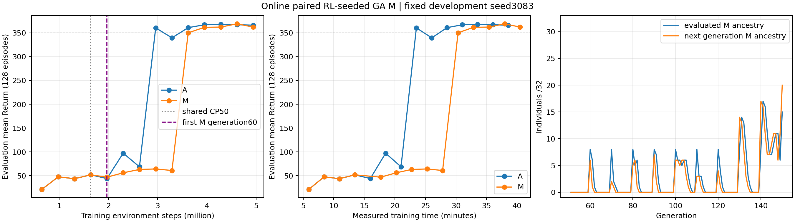

# Online RL-guided GA M: real single-seed Pilot result

Implementation and real evolution PASS; this fixed candidate did not improve learning efficiency. Primary AUC60-150 is25.35% below Uniform A. Do not scale this candidate or claim a positive Utility mechanism from this run.

## Frozen experiment

- Training commit30a4226; basef1cdb57. Seed3083 reused for its complete frozen Uniform A CP50, not chosen by M outcomes. Source branchcodex/rl-guided-population-pilot.
- Complete CP50 learner/targets/Adam/Replay/GA/PRNG/runtime restored with exact native state SHA. Original A remains frozen. The recorded initial implementation-only CP10/start40 idea was changed before any M performance run to CP50/start60 for closer full-state reuse and less rerunning.
- Atg60,70,...150, replace tail8 of32 by4 paired RL Actor+/-0.005*epsilon policies from the current pre-step Actor. Preserve first24 and original every10g single-Actor injection; normal GA Fitness/tournament/elite/mutation/breeding remains active. Uniform Replay and TD3 update code unchanged.
- Prospective primary:g60..150 AUC over1.97M..4.94M environment steps. g20..150 AUC auxiliary with identical frozen20..50 prefix. Eval every10g x128episodes, first scheduled meanReturn>=350 secondary. No interim tuning or new seed.
- Final logical budgets match:4.94M training steps,2.24M Actor/4.48M Critic optimizer updates. Newly executed M:g51..150,3.30M training+1.28M evaluation steps. Utility diagnostics add0 environment steps.

## Performance and real cost

AUC entries are divided by1e6 Return*environment-step units.

| Arm | Primary AUC60-150 | Auxiliary AUC20-150 | Last5 mean | Final Return | First>=350:g/steps | Minutes to threshold | Total training minutes |
|---|---:|---:|---:|---:|---|---:|---:|
|A|836.1375|894.0497|365.7987|366.1118|90 / 2,960,000|23.5234|38.5727|
|M|624.1516|682.5418|360.9985|362.1765|110 / 3,620,000|30.3465|40.4905|

M/A primary-25.35%; auxiliary-23.66%; total measured training cost+4.97%. M requires660,000 more steps to the threshold and29.01% more measured training time.

Time charges the actual shared A prefix throughCP50 (13.4487minutes), plus synchronous new M steps including injection/pedigree/receipts; excludes evaluation/checkpoint I/O. New M process wall:28.8341minutes; frozen diagnostics:67.63seconds. M first resumed step:93.16s versus A51:15.45s, so roughly78s of115s extra total cost is cold-resume compilation. Steadyg52..150 means:15.448s M versus15.071s A. This is not a pure GPU-kernel benchmark.

## Actual multi-generation evolution and diversity

80 injected candidates were really evaluated. They generated217 subsequent ancestry source-slots (194 normal GA offspring and23 retained elite copies), in addition to80 fresh candidate slots (297 total M-ancestry evaluated source-slots out of3,200 EA slots). There were241 actual M-parent selections,37 generations with M breeding and45 with M-ancestry Fitness evaluation. g150 evaluates15 M-ancestry individuals; normal tell produces20/32 M-ancestry individuals for the next population. That next population is saved but g151 was not rolled out.

Maximum observed root-cohort age after birth:60:2,70:2,80:3,90:2,100:7,110:3,120:2,130:5,140:>=10,150:>=0 generations. The last two are right-censored atCP150. Age2 means three evaluated generations including birth, not two independent offspring seeds.

No full ancestry takeover: at least15/32 evaluated individuals had no M ancestor throughout the100 new generations; the saved next population has12/32 without M ancestry. This genealogical count is not itself behavioral diversity.

| Post-GA checkpoint population | A fixed-observation mean pair distance | M distance | M/A change |
|---|---:|---:|---:|
|50|0.936958|0.936958|+0.00%|
|100|1.487760|1.098197|-26.18%|
|150|1.563872|1.468768|-6.08%|

Fixed observations come from sharedCP50 and remain unchanged. These are post-GA next-population metrics; Utility below uses the actual evaluated-generation Replay sources. Nine of ten immediate replacements increase whole-population pair distance;g150 decreases it. Thus this run does not support a simple population-collapse explanation, although M diversity is lower than A at measured late checkpoints.

## Real frozen-learner Utility

AtCP50/100/150, score actual same-generation resident A-EA and M-EA experiences plus M RL-own and Replay-random in ONE frozen M learner/target/Adam snapshot and3 common M-Replay references.256 valid transitions per source, unchanged TD3 loss and real discarded Optax update at step1. This is explicit post-update checkpoint Utility, not pre-exposure D0 Utility. No future data or Replay write; both restored full-state hashes unchanged after every diagnostic.

CP50 is pre-intervention calibration: A and M use the same32 physical EA sources; all96 paired Utility measurements match exactly (maximum difference0). These duplicated calibration labels are not independent sources. CP100 has no already-evaluated M descendants; its6 post-tell M individuals belong to generation101 and are not mislabeled as generation100 experience.

Below mean/median/positive rate are across per-source means of3references. Utility columns x1e3. The complete file also preserves per-reference positivity, Fitness, Critic loss and trajectory-conditioned behavior distance.

| CP | Source | Distinct source IDs / reference rows | Mean Utility x1e3 | Median x1e3 | Positive source means | Mean Fitness | Trajectory distance to current RL |
|---|---|---:|---:|---:|---:|---:|---:|
|100|M-direct|8/24|-6.058580|-5.606305|0.00%|61.380|0.639746|
|100|M-no-derived-ancestry|24/72|-2.844651|-1.351370|0.00%|84.868|1.900089|
|100|Original-EA-A|32/96|-11.735943|-6.112989|0.00%|71.968|1.569909|
|100|RL-own|1/3|-6.668439|-6.668439|0.00%|65.174|0.668415|
|100|Replay-random|1/3|-0.946941|-0.946941|0.00%|-|1.723885|
|150|M-descendant|7/21|-6.307040|-0.854245|0.00%|114.317|1.286585|
|150|M-direct|8/24|-0.255158|-0.258143|0.00%|365.165|0.083770|
|150|M-no-derived-ancestry|17/51|-1.688841|-1.041539|5.88%|75.475|1.657890|
|150|Original-EA-A|32/96|-9.284833|-3.658579|0.00%|66.880|1.566456|
|150|RL-own|1/3|-0.219285|-0.219285|0.00%|356.332|0.150225|
|150|Replay-random|1/3|-0.224939|-0.224939|0.00%|-|1.318622|

594 raw reference-measurement rows are not594 independent sources or training seeds. GA relatives and opposite pairs are correlated. RL-own has exploration noise, while EA policies do not; its action distance/Fitness is not a clean mutation-only control. Trajectory distances also include movement of the Actor between experience generation and the post-update snapshot; the pre-step fixed-observation injection geometry separately measures small perturbations.

Direct M has less-negative Utility than counterfactual A-EA at both post-intervention checkpoints, but atCP100 is worse than M own no-M-ancestry EA. AtCP150 direct M is relatively good, while descendant mean is worse than the M no-M group (its median is slightly better, with only7 related sources). Direct M is not better than RL-own or Replay-random atCP150; source-mean Utility is negative throughout these M groups. There is no stable broad claim that derived descendants produce more beneficial learner updates.

Cross-run A sources were not exposed to the M learner during training, whereas M sources were. All are evaluated with the same critic, but familiarity/exposure differs. Consequently the cross-run gap cannot identify an intrinsic Utility advantage of origin. Within-M comparisons are more directly comparable. Replay-random is also negative, so less-negative does not mean positive one-step benefit.

## Mechanism interpretation and decision

- Earlyg60..100 fresh M mean Fitness55.15,40.33,66.93,63.97,61.38 versus other24 means117.69,129.33,99.80,90.98,84.87. These cohorts are usually short-lived. Lateg130..150 fresh M Fitness359.87,365.77,365.17 exceeds other24 means187.59,177.75,86.80 and ancestry survives longer. Timing/Actor quality matters descriptively.
- Pure fresh-only injection groups atg60..140 have fixed-observation distance0.0425..0.0794 from their generating RL Actor. This is evidence of nearby behavior, not proof that perturbation preserves Fitness under every initial condition.
-194 observed M nonelite parent-child relations have Fitness delta mean-147.44,median-64.36;23 M elite-copy relations mean-0.61,median-0.36. Original non-M nonelite mean-128.70. Standard GA variation is associated with substantial offspring Fitness erosion; this is not a controlled proof that Gaussian seeding causes it. Environment reset and selection/regression also contribute.
- The evidence points to weak early Actors and short/fragile evolutionary retention as plausible issues. It does not uniquely separate early intervention, mutation harm or altered exploration: no delayed-start/unmutated-EC/protected-descendant control was trained. Diversity did not collapse, so suppressing all independent exploration is not supported.
- Current decision: do not add expensive Utility-guided Replay/selection or scale M as a positive method. If continuing, first preregister ONE delayed-start control while keeping mutation/fraction/period fixed; test whether avoiding weak early Actor experience changes the result. Protecting descendant variation is a separate later factor, not a simultaneous retune. No new candidate was launched.
- This is one development-seed Pilot; it neither establishes a general benefit nor statistically rejects RL-guided evolution.

## Verification, files and retained artifacts

9 targeted tests PASS; real Brax/Swimmer GPU Smoke PASS. Exact parameter SHA at actual EC collector input, and actual collector obs/actions copied bitwise into Replay at all10 intervention events. Fixed population/episodes/update budgets and final baseline/GA PRNG streams PASS. GA parent metadata matches original optimizer outputs, including normal single-Actor injection. No evorl/ or TD3/sampling formula modifications.

GPU float comparison initially used inappropriate exact hashes; original baseline repeats also vary. Final Smoke keeps exact GA/discrete/PRNG/provenance checks and explicit1e-4 float tolerance. Independent policy forward recomputation also depends on GPU batching, so the source proof uses exact actual collector receipts. Five failed tiny Smoke attempts are preserved, plus the final PASS; none contaminate the native formal initial state. They are verification overhead, separate from the fixed training budget.

Implementation files: scripts/rl_guided_population.py; scripts/run_rl_guided_population_pilot.py; scripts/diagnose_rl_guided_population.py; scripts/analyze_rl_guided_population.py; tests/test_rl_guided_population.py. Supplemental CPU pedigree analysis:scripts/analyze_rl_guided_mechanism.py. Full method contract:rl_guided_population_pilot.md.

All artifacts remain remote; no Windows artifact files were created.

    /disk1/zmh_projects/evorl_artifacts/learner_utility_replay_pilot/algorithm/rl-guided-population-seed3083-v1

Contains preregistration/config manifest/source hashes, full native CP50/100/150, per-generation evaluated/next pedigrees, Fitness, injection parameter hashes and receipts, raw logs (including failed Smoke), fixed observations,594 Utility rows, frozen-state checks, source summaries, mechanism/timing details, CSV and PNG/PDF curves. Original A and all previous branches/results are untouched.

LCERL motivation and limitations are recorded in the method contract; this minimal Gaussian paired operator is not a reproduction of its adaptive mutation/archive architecture.
