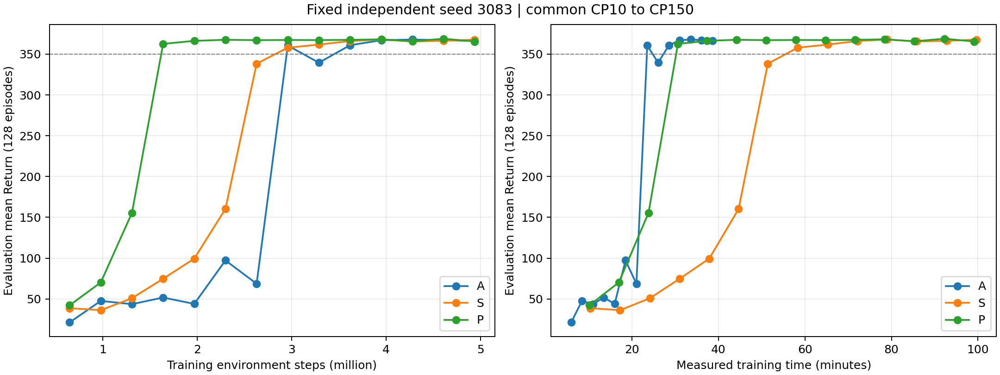

# Independent seed3083 Utility-ranking replication

Completed A/S/P through CP150 on one RTX4090, without interruption or interim tuning. The additional benefit of true Utility ranking did not replicate: S/P primary AUC is -23.17%, reversing the +9.22% direction in seed3079. Both weighted schedules beat Uniform in environment-step AUC, but P is faster than S. This is a mixed outcome under the pre-run descriptive route rule, not a successful replication of ranking-specific benefit.

## Fixed contract and provenance

- Training commit: 1aafee943bd42c51aa847ef567c403e310461a1a; algorithm parent: ba5c5708703a2ef30b8399157a87655ca1bb2d1c.
- Seed3083 was fixed before outcomes; no exact use in 170 prior seed/config/manifest registry files. No replacement seed was tried.
- New complete A CP10 was restored for S and P; full-state SHA256 e8453f3207dece0cc2c82c74566ced56e883d7c95fa6a4051221ed32194c03bf. Learner/targets, Adam state, Replay, source bookkeeping and PRNG are shared at that point.
- Swimmer1000; population32; actor/critic hidden sizes[256,256]; batch/source256; alpha0.5; temperature0.5; freshness30. No changes to evorl/, TD3, the corrected sampler, or existing P implementation.
- S/P use exactly the same 3/4-source quota each generation:32 scores per10 generations,448 real Utility measurements each. P performs the same scoring and changes only the within-cohort rank-to-source mapping; all140 permutation records preserve eligible rank multisets.
- Each arm ends at4.94M logical training steps and CP150; from CP10:4.62M new steps,2.24M Actor and4.48M Critic optimizer updates. Evaluations every10 generations20..150,128 episodes each.
- Primary AUC: trapezoidal Return integral over650,000..4,940,000 training steps (g20..150). Late AUC:g70..150,2.30M..4.94M steps. Threshold:first scheduled evaluation mean>=350, without imputation or consecutive-hit rules.
- Timing: measured common init/warmup128.8574 seconds charged to each arm, plus synchronized workflow.step wall seconds. Includes compilation/rollout/scoring; excludes evaluation/checkpoint I/O. Process wall seconds are separately retained. No conversion from steps to seconds.

## Results

AUC values below are divided by1e6 Return*environment-step units.

| Arm | AUC20-150 | AUC50-150 | AUC70-150 | Final5 mean | Final Return |
|---|---:|---:|---:|---:|---:|
| A | 894.0497 | 851.9229 | 812.8483 | 365.7987 | 366.1118 |
| S | 1038.9915 | 991.5177 | 919.9271 | 366.7033 | 367.7212 |
| P | 1352.2597 | 1210.9814 | 969.6438 | 367.1319 | 365.5118 |

| Contrast | AUC20-150 | AUC50-150 | AUC70-150 |
|---|---:|---:|---:|
| S/A | +16.21% | +16.39% | +13.17% |
| P/A | +51.25% | +42.15% | +19.29% |
| S/P | -23.17% | -18.12% | -5.13% |

| Arm | First>=350 generation | Training steps | Training minutes to threshold | Total training minutes | Process wall minutes |
|---|---:|---:|---:|---:|---:|
| A | 90 | 2,960,000 | 23.5234 | 38.5727 | 40.9111 |
| S | 90 | 2,960,000 | 58.2941 | 99.6104 | 99.5823 |
| P | 50 | 1,640,000 | 30.6118 | 99.1004 | 99.1130 |

S reaches the threshold at the same2.96M steps as A and takes2.478x the measured training time. P reaches it at1.64M steps (44.59% fewer), yet takes30.13% more measured training time. Environment efficiency is not a computation-efficiency gain.

Total measured training cost is2.582x A for S and2.569x for P. Three sequential run process walls sum to3.9934 hours. These are actual wall measurements, not CUDA-kernel-only timings; warmup is physically collected once but logically charged to all arms.

## Necessary validity checks

- All140 generations per arm completed; no recovery/discarded-attempt scores. Every generation matched its scoring quota and baseline PRNG-advance contract. Final core/EA PRNG streams match across arms; learned weights and Replay content may diverge as intended.
- S/P g20 andg150 actual Critic input traces passed:32,000 true Critic batches each; no invalid index, no changed RL slot, no changed EA/RL origin ratio. EA indices are changed by the weighted path.
- S/P mean eligible coverage:9.0995%/9.0995%; mean EA-conditional TV:1.4781%/1.4781%. The coverage and intervention magnitudes match; index-change counts are not used as the intervention-strength metric.
- Three targeted new runner tests passed (seed/config binding, existing P permutation with seed3083, inclusive first-threshold/recorded timing). No rerun of the189 historical tests or previous GPU experiments.
- New physical environment budget:14.18M training steps (shared warmup320k plus3x4.62M),5.376M evaluation steps. No environment rollouts for Utility diagnostics.

## Interpretation and next decision

Seed3079 remains frozen and separate: S/A primary+91.85%, P/A+75.66%, S/P+9.22%, and S/P late AUC almost equal. In seed3083 these are+16.21%,+51.25%,-23.17%, and late S/P-5.13%. The ranking-specific direction reverses; this provides no repeatable extra benefit of true Utility ranking. Final Returns are close, so the AUC differences reflect learning timing rather than a higher final plateau.

Both S and P beating A in the two development seeds supports investigating the common nonuniform-source-sampling mechanism. It does not identify scoring schedule alone as the cause: P retains true Utility calculations, eligibility and nonuniform ranks, and differs from A in several coupled mechanisms. Two development seeds are descriptive evidence, not a formal multi-seed result.

Do not expand Full Utility coverage, increase scoring repetitions, or launch long formal runs on the current ranking claim. The next minimal research candidate is Utility-free random within-cohort rank weights with the same source schedule, eligibility/residency and EA/RL slots. This could remove real virtual-update scoring cost, but has not been trained here and must not inherit P performance by assumption. Its exact eligibility rule and timing would need a controlled small comparison. No such new experiment is launched.

## Reproduction and retained outputs

All original checkpoints and seed3079 results remain untouched. All new files are on the remote server; none were written to Windows artifacts.

    /disk1/zmh_projects/evorl_artifacts/learner_utility_replay_pilot/algorithm/s-utility-replication-seed3083-v1

Includes preregistration.json, seed_check.json, protocol YAML/manifest, shared_warmup.json, raw training.log, runs/{A,S,P}/ full native CP10/50/100/150, per-generation schedules, g20/g150 Critic input traces, P permutation records, evaluation_timing journals, summary*.json, comparison.json, learning_curves.csv/png/pdf and analysis.log.

Recompute completed-results statistics and figures with base Python (Matplotlib available there):

    cd /disk1/zmh_projects/evorl_worktrees/d0-sampler-fidelity
    /home/admin001/anaconda3/bin/python -m scripts.analyze_s_utility_replication

Training environment: /home/admin001/anaconda3/envs/evorl-conflict. Original launch was in tmux evorl-utility:utility-replication; all training has now exited normally.
