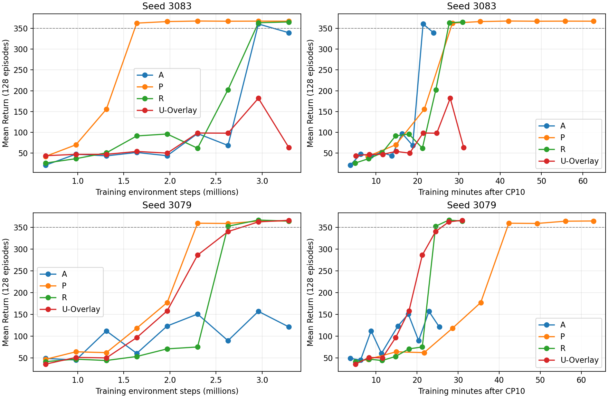

# U-Overlay CP100 mechanism control

Uniform EA replacement reproduced the AUC improvement over A on seed 3079 and reversed it on seed 3083.
In this pilot, source-level nonuniform weights were unnecessary for the seed 3079 AUC improvement.
The effect of the uniform overlay varied by seed. The comparison with A changes both the EA sampling path
and its RNG stream, so it cannot separate their individual effects.

## Protocol

Both Swimmer runs restored the original A CP10 full state and ran to CP100 in a single remote tmux window.
The common budget was 3.29M cumulative training steps, 2.97M after CP10, with 1.44M actor updates
and 2.88M critic updates. Population 32, network [256,256], batch 256, and 128 evaluation episodes every
10 generations from CP20 were inherited from the frozen controls. A/P/R were read from their frozen logs.
The primary metric is trapezoidal Return AUC at 650k to 3.29M environment steps (CP20 to CP100).

U preserves R's weighted sampler, intervention key, source registry, schedule, and RL/EA slot masks.
At the actual learner call it replaces the distribution with equal mass per resident EA transition.
A source with more resident transitions therefore has proportionally more total mass, as in A's Uniform Replay.
The runner still uses alpha=0.5 to enter the same learner path as R. The realized EA conditional TV is zero.
R's synthetic priorities are maintained as matched bookkeeping and do not affect U's sampling probability.
U performs zero Utility measurements, virtual updates and reference/source minibatch construction. It adds no rollout.

## Results

Training time sums synchronized CP11 to CP100 training steps, including compilation, excluding shared warmup,
evaluation and checkpoint I/O. Threshold timing uses the first scheduled evaluation at mean Return >=350.

| Seed | Arm | AUC (millions) | CP100 Return | Training min | First 350 (steps / training min) |
|---|---|---:|---:|---:|---:|
| 3083 | A | 294.868 | 339.53 | 23.89 | 2,960,000 / 21.38 |
| 3083 | P | 746.216 | 367.19 | 62.58 | 1,640,000 / 28.46 |
| 3083 | R | 362.636 | 365.33 | 30.95 | 2,960,000 / 27.71 |
| 3083 | U-Overlay | 208.315 | 63.71 | 31.19 | - |
| 3079 | A | 271.393 | 121.19 | 25.41 | - |
| 3079 | P | 564.350 | 364.83 | 62.98 | 2,300,000 / 42.36 |
| 3079 | R | 400.049 | 364.52 | 31.01 | 2,630,000 / 24.53 |
| 3079 | U-Overlay | 510.154 | 366.43 | 30.97 | 2,960,000 / 27.73 |

Seed 3083: U/A AUC -29.35%, U/R -42.56%, R/A +22.98%. U did not reach 350 by CP100.
Seed 3079: U/A AUC +87.98%, U/R +27.52%, R/A +47.41%. U reached 350 after R by 330k steps,
despite higher AUC over the full interval. R reached 350 at CP80 and U at CP90.
U process wall time including evaluation and I/O was 32.90 and 32.65 minutes respectively.

## Verification and limits

The Brax GPU smoke used the actual learner and blocked all Utility paths. U and R selected the same
sources in all 90 generations per seed. Full TD3 audits at CP20 and CP100 for each U verified uniform
support on resident EA indices, effective CDF TV below 1e-11, actual EA replacements, and unchanged RL indices.
Read-only checksum-verified R/U CP100 restores matched the intervention, training and GA keys and budgets.
The first seed 3083 attempt stopped in the CP20 audit because device reciprocal rounding differed from
the CPU reference by one float32 ULP. Exact equality across EA masses and strict CDF TV were checked separately
in the revised audit. The learner and sampler were untouched. The rerun restored sealed CP10 and the
failed run segment and log are retained. The extra attempt consumed 330k training and 128k evaluation steps.
Final accepted pilots total 5.94M new training steps and 2.304M evaluation steps, plus the failed audit attempt
and the tiny GPU smoke. Each result includes the same nine evaluation checkpoints.

This two-seed control points to a seed-sensitive sampling effect. Keep U as the matched control and test
an independent seed or a sampling hypothesis with a specified mechanism before scaling.
No parameter selection on these two seeds was performed.

All raw logs, manifests and checkpoints are on the server under `/disk1/zmh_projects/evorl_artifacts/learner_utility_replay_pilot/algorithm/uniform-overlay-cp100-v1`.
